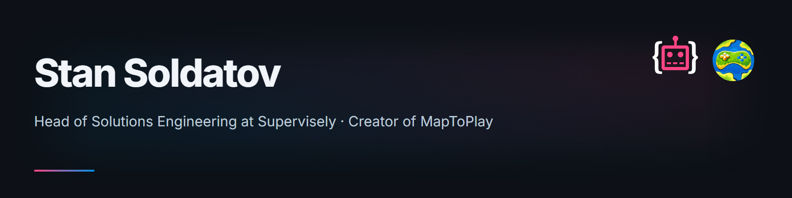
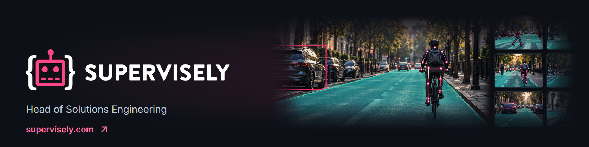
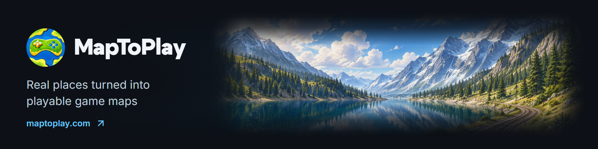

## Hi! I'm Stan 👋

I'm a software engineer. That's the short and slightly boring version.

The honest version is that I care a lot about what coders can do for people.

I believe people are here to create. Our time and attention are the most valuable resources we have, and it genuinely hurts to see them spent on repeating steps, moving data from one place to another, and doing work a machine should have handled for us years ago. People are astonishingly good at imagining, judging, caring, and making something new. We should not waste that by asking them to behave like slow computers.

I want to automate everything that does not deserve a human mind. Not to squeeze more output from people, but to give them more of their lives back. Let software carry the repetition, the complexity, and the boring mechanical work. Let the human carry the idea.

That is the part of coding that still feels a little like magic to me. We can hide millions of decisions and a frankly unreasonable amount of code behind a couple of buttons, and suddenly someone can do something that was difficult, frustrating, or completely out of reach before.

Not everything we build has to save the world. Sometimes it helps a pizza arrive faster. Sometimes it turns a real place into a world someone can play in (I happen to know a guy). But if it gives someone time back, helps them create something, or makes one annoying part of life disappear, then it matters.

This is also why I care about architecture, reliability, and good interfaces. Not because they look impressive on a diagram. Because there is a real person at the other end, and they should not need to know how much complexity, panic, and coffee went into making that button work.

I want to build software that is ambitious and complicated on my side, then clear and almost boring on yours. In the best possible way.

Let's make something that matters. 🌍

---

### What I actually do

I see a product from the user's side first. I do not only think about how something can be built, even though I know that part very well. The more important question is how it should be used. What is the person really trying to achieve? What will feel natural? What should happen automatically? Which pieces of complexity should they never have to see?

I turn technical experience and deep domain knowledge into real product planning. I can take a rough idea, find the valuable part inside it, shape the experience around the people who need it, and carry that intent through architecture, implementation, release, and operation. The same principle applies to any difficult system: understand the complexity completely, then refuse to pass that complexity on to the user.

I notice rough edges. The unnecessary click, the confusing word, the workflow that makes perfect sense to the developer and no sense to anyone else. I keep polishing, watching how people actually use the product, questioning old decisions, and improving it again. The perfect product is impossible, which is slightly inconvenient because I intend to keep moving toward it anyway.

#### Do slightly unreasonable things with maps

GIS is not just my deepest specialist domain. It is the part I genuinely love. Give me terrain, imagery, OpenStreetMap data, strange coordinate systems, or two datasets that insist the same point exists in two different places, and I am happy. I know the pleasant parts, the ugly parts, and quite a few parts that probably should not be possible but somehow are.

There is something beautiful about taking the huge, messy physical world, understanding it through data, and turning it into a tool that lets someone create a world of their own.

### Supervisely

I'm Head of Solutions Engineering at [Supervisely](https://supervisely.com), the computer vision platform.

### MapToPlay

I am the creator and sole developer of [MapToPlay](https://maptoplay.com), a platform that helps people turn real-world geographic data into playable maps and game mods.

MapToPlay brings together terrain models, imagery, OpenStreetMap data, multiple geospatial providers, a live editor, and exports for games including Farming Simulator, Minecraft, and Project Zomboid. It started as maps4fs and, apparently unaware that side projects are supposed to stay small, grew into a complete platform used by creators around the world.

I built all of it myself: the product and UX, system architecture, application and data layers, geospatial processing engines, background workloads, provider integrations, infrastructure, deployment, operations, documentation, and user support. There is no mysterious other department to blame. I checked.

MapToPlay is built around the same belief. A creator should spend time deciding what kind of world they want to make, not downloading tiles, reconciling coordinate systems, processing terrain, or repeating fifty mechanical steps before creativity can even begin. The platform does the machine work so they can do the human work.

Building MapToPlay solo means following every problem from a person's idea, through spatial mathematics and distributed processing, all the way to a working result on their screen. It is the clearest example of how I work. I can hold a large, complicated system together, build and run every part of it, and still remember that the point is not the system. The point is what somebody gets to create with it, and the time they get to spend creating it.

### Find me

[maptoplay.com](https://maptoplay.com) · [MapToPlay Discord](https://maptoplay.com/go/discord) · [YouTube](https://maptoplay.com/go/youtube) · [LinkedIn](https://www.linkedin.com/in/iwatkot/)
